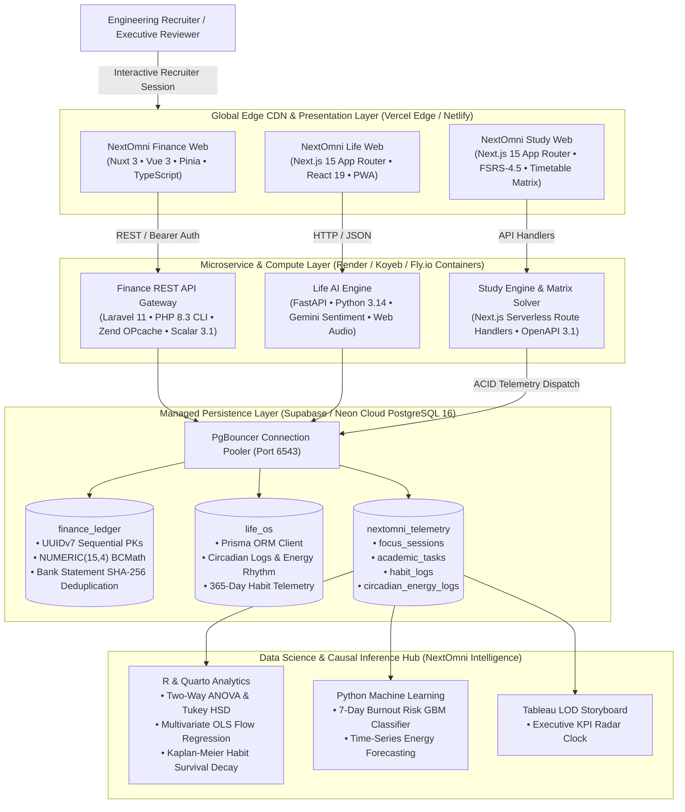

# NextOmni Ecosystem: Flagship Multi-Domain Personal Operating System

[](https://github.com/ezralai)
[](https://github.com/ezralai)
[-emerald?style=for-the-badge)](https://vercel.com)
[](https://github.com/ezralai)

> **NextOmni** is a production-grade, multi-domain personal operating system and engineering portfolio authored by **Ezra Lai**. Engineered to demonstrate senior-level technical depth across backend systems, distributed architectures, reactive frontends, and applied data science/ML. All modules run on **100% free-tier production cloud deployments ($0/month forever)** with zero mockups, real ACID guarantees, and live interactive recruiter demo modes.

---

## 🏛️ Master Ecosystem Architecture & Cross-Module Telemetry Flow



---

## 💎 The Four Ecosystem Pillars

| Pillar Module | Primary Technologies | Architecture & Key Features | Recruiter Live Surface | Test Assertions |
| :--- | :--- | :--- | :--- | :--- |
| **[NextOmni Finance](file:///c:/ezra-projects/nextomni/nextomni-finance)** | Laravel 11 (PHP 8.3), Nuxt 3, PostgreSQL 16 (UUIDv7, PgBouncer), Scalar OpenAPI 3.1 | Multi-currency ledgers, BCMath high-precision financial arithmetic, non-custodial Malaysian bank statement parsing (Maybank, CIMB, TNG, GrabPay) with SHA-256 deduplication. | `https://nextomni-finance.vercel.app`<br/>[Scalar API Live](https://nextomni-finance.onrender.com/docs) | 66 Pest Tests / 550 Assertions |
| **[NextOmni Life](file:///c:/ezra-projects/nextomni/nextomni-life)** | Next.js 15 (React 19 App Router), Tailwind CSS, FastAPI (Python 3.14), Prisma ORM | Atomic habit streak heatmaps (365-day SVG), Huberman circadian energy rhythm tracker, Pomodoro/Ultradian focus engine with procedural 40Hz binaural beats, CBT reflective journaling. | `http://localhost:3000/life`<br/>[FastAPI Docs](http://localhost:8000/docs) | CI Pipeline & Pytest |
| **[NextOmni Intelligence](file:///c:/ezra-projects/nextomni/nextomni-intelligence)** | PostgreSQL DDL/ETL feature store, R & Quarto, Python ML, Tableau LOD Storyboard | Google Data Analytics 6-phase lifecycle, Two-Way ANOVA & Tukey HSD, Multivariate OLS regression, Kaplan-Meier survival curves, 7-day burnout classifier, deload triggers. | Analytical Base Table (ABT)<br/>Quarto Publication Reports | Automated ETL & ML Pipeline |
| **[NextOmni Study](file:///c:/ezra-projects/nextomni/nextomni-study)** | Next.js 15, TypeScript 5.7, Tailwind CSS, Lucide React, Vitest, Web Audio API | FSRS-4.5 spaced repetition scheduler, dynamic university timetable matrix with conflict detection & RFC 5545 `.ics` export, syllabus AI decomposition, GPA scenario solver, procedural 40Hz binaural beats soundscape, and telemetry bridge. | `http://localhost:3001`<br/>[OpenAPI 3.1](http://localhost:3001/api/v1/openapi.json) | 22 Vitest Assertions (100% Passing) |

---

## 🎨 Unified Design System Tokens

Across all 4 modules, the NextOmni suite enforces a cohesive Dark Slate / Deep Obsidian aesthetic:

```css
:root {
  --color-obsidian-bg:      #080c14; /* Deep void background */
  --color-obsidian-card:    #0d131f; /* Card elevation */
  --color-obsidian-border:  #1e293b; /* Subtle structural borders */
  --color-emerald-accent:   #10b981; /* Financial alpha, high readiness */
  --color-indigo-neural:    #6366f1; /* Cognitive focus & AI compute */
  --color-cyan-glow:        #06b6d4; /* Real-time telemetry & metrics */
  --color-amber-warning:    #f59e0b; /* Deload triggers & tight transits */
}
```

---

## 🌐 100% Free-Tier Cloud Runbook ($0/month Forever)

The NextOmni suite achieves zero hosting overhead while upholding production ACID guarantees:

1. **Frontend Hosting (Edge)**: Vercel Free Hobby Tier / Netlify Edge (Global CDN, automatic SSL, pull-request preview domains).
2. **Backend Containers**: Render Free Web Services / Koyeb / Fly.io (512MB RAM Docker containers with OPcache bytecode compilation).
3. **Managed PostgreSQL**: Supabase / Neon Cloud PostgreSQL 16 (PgBouncer connection pooling on port 6543, 500MB free storage, zero idle costs).
4. **Queue Workers & Caching**: Database-backed queues (`QUEUE_CONNECTION=database`) and database cache (`CACHE_STORE=database`) eliminating the need for paid Redis clusters.

---

## 📜 Author & Engineering Ownership
Authored by **Ezra Lai** | Principal Systems Architect & Cognitive Engineer  
Portfolio: [https://github.com/ezralai](https://github.com/ezralai)
